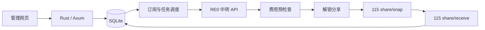

# 中转与 115 请求协议

依据 TgtoDrive 8.7.16 成品分析、原生客户端受控回放和镜像所附 p115client 0.0.9.0.2。完整调查文件位于工作空间的 `investigation/REPORT.zh-CN.md`。此 App 独立实现协议，不包含成品代码或签名密钥。

## RE0 中转

默认网关：`https://re0.tgtodrive.top`。

签名输入为七个字段用换行连接（没有末尾换行）：

```text
UPPERCASE_HTTP_METHOD
URL_PATH
NORMALIZED_QUERY
INSTALL_ID
UNIX_TIMESTAMP_SECONDS
NONCE
HEX_SHA256_OF_EXACT_BODY_BYTES
```

查询参数去除 `sig` 和 `signature`，按键和值排序，保留空值，再按 URL form encoding 编码（空格为 `+`）。签名是 `HMAC-SHA256(key, canonical)` 的小写十六进制结果。

API Header：`X-Install-Id`、`X-Timestamp`、`X-Nonce`、`X-Signature`。JSON body 使用紧凑序列化，签名与发送的是同一份字节，不在签名后修改。

| 操作 | 方法与路径 | 参数 |
|---|---|---|
| 授权 | 浏览器 GET `/auth/start` | query: `install_id, ts, nonce, sig` |
| 授权状态 | GET `/api/token/status` | 无 body |
| 用户状态 | GET `/api/me` | 无 body |
| 资源查询 | GET `/api/resources/{movie或tv}/{tmdb_id}` | 无 body |
| 费用详情 | GET `/api/shares/{slug}` | 无 body |
| 解锁 | POST `/api/resources/unlock` | `{"slug":"..."}` |
| 普通签到 | POST `/api/checkin` | `{"is_gambler":false}` |

授权链接也按相同规则签名，`sig` 不参与计算。状态响应可以使用 `success:true` 与符号码（如 `REAUTH_REQUIRED`）；不得把所有非数字 code 判为 HTTP/业务失败。App 的 `/api/me` 对外只返回显示所需字段。

解锁结果读取 `data.full_url` / `data.url`，可用独立 `data.access_code` 补入口令。积分只在解锁之前查询，本地上限无法消除读取费用和执行解锁之间的竞态。

## 115 分享接收

允许分享域名 `115.com`、`115cdn.com`、`anxia.com` 及其子域，路径 `/s/{share_code}`。口令读取 query 的 `password`、`pwd`、`receive_code`、`access_code`。

1. GET `https://webapi.115.com/share/snap`，不发送目标账号 Cookie。
2. 参数 `share_code, receive_code, cid=0, offset, limit=100, app_ver=99.99.99.99`。
3. 最多 120 页，文件/目录取非零的 `fid` / `cid` / `file_id`，去重；保持目录作为顶层接收条目，不递归下载文件。
4. POST `https://webapi.115.com/share/receive`，发送目标账号 Cookie 和 form body：`share_code, receive_code, file_id=逗号分隔ID, cid=目标目录ID`。
5. 只有明确的 `state:true` 或“无需重复接收”响应才能标记接收成功。失败、缺少成功标识或响应中断都保留为待核对。

此流程不经过开发者 OpenAPI，不下载再上传文件。

## 模块职责

| 文件 | 职责 |
|---|---|
| `src/providers.rs` | 签名、服务适配、结果归一化、115 分页接收 |
| `src/engine.rs` | 订阅调度、任务阶段、积分预检查、账号上下文 |
| `src/store.rs` | SQLite 队列、原子去重、加密配置、重启恢复 |
| `src/web.rs` | 会话、管理员初始化、CSRF、管理 API、嵌入静态文件 |
| `web/` | 独立管理界面 |


